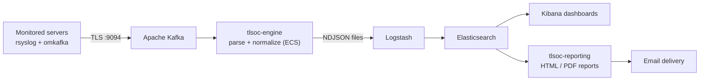
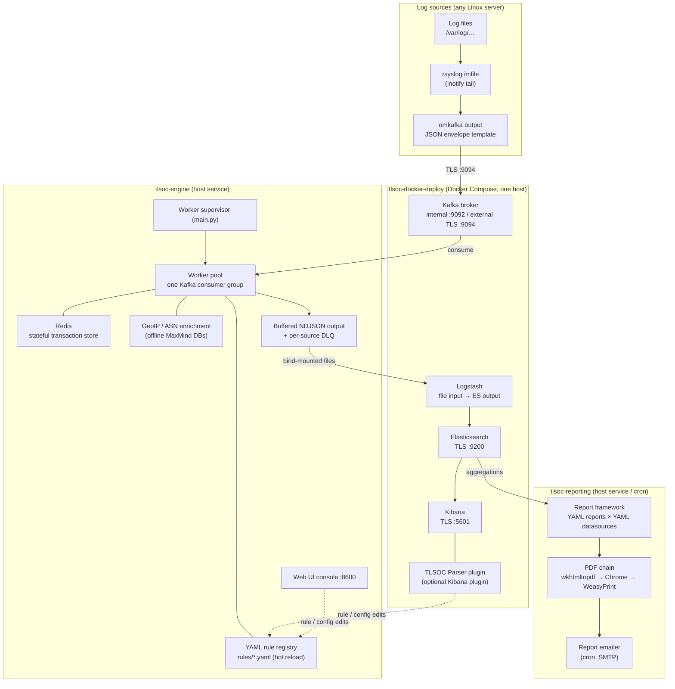
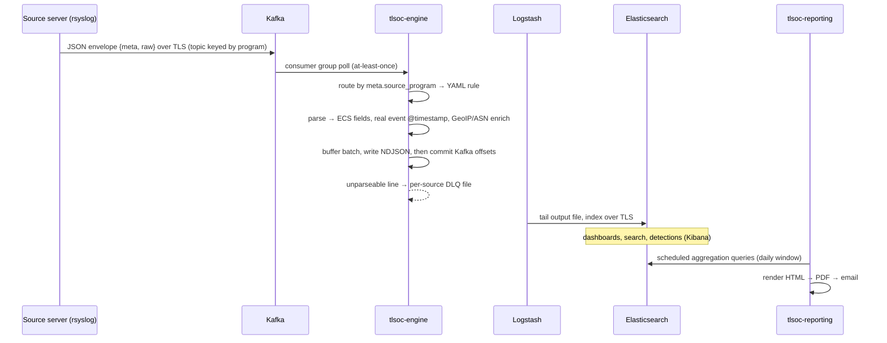
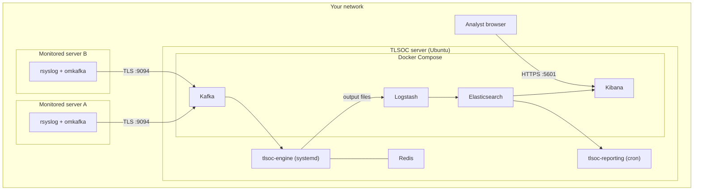
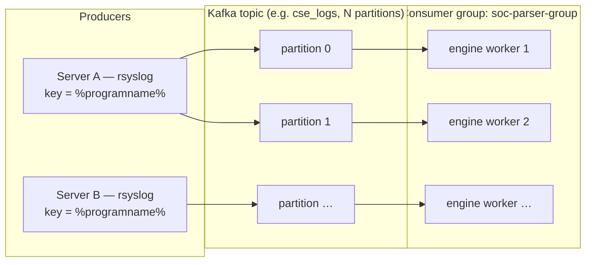
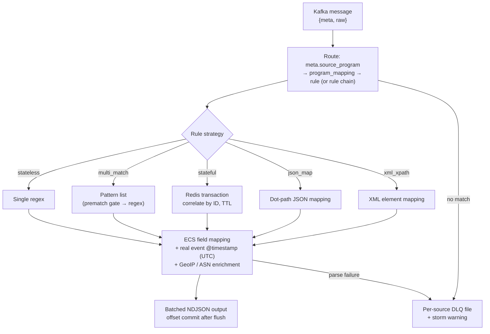
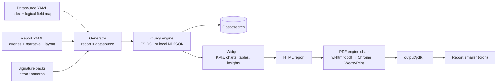

# TLSOC Architecture

This document describes the architecture of the TLSOC platform across all its
repositories. Component-level internals are documented in each repository's own
`docs/` directory; this is the ecosystem-wide view.

## Contents

- [High-level architecture](#high-level-architecture)
- [Component architecture](#component-architecture)
- [Data flow](#data-flow)
- [Deployment topology](#deployment-topology)
- [Communication and ports](#communication-and-ports)
- [Kafka flow](#kafka-flow)
- [Parser pipeline](#parser-pipeline)
- [Reporting pipeline](#reporting-pipeline)

## High-level architecture

TLSOC is a pipeline of four cooperating systems: agentless collection, TLS-secured
transport and storage, ECS normalization, and reporting.



## Component architecture



## Data flow

The life of one log line, end to end:



**The Kafka envelope contract** — every producer (the onboarding script, rsyslog
template, Filebeat, Vector, or a custom script) sends messages of this shape:

```json
{
  "meta": {
    "org": "example_org",
    "dept": "it",
    "env": "production",
    "server": "web_server_1",
    "source_host": "web01",
    "source_program": "nginx_access"
  },
  "raw": "the original log line"
}
```

`meta.source_program` is the routing key that selects the parsing rule;
everything else under `meta` is carried through to the indexed event untouched.

## Deployment topology

The reference deployment uses one central TLSOC server plus any number of
monitored servers. Every arrow crossing a machine boundary is TLS-encrypted.



Scaling out: the engine's workers form a single Kafka consumer group, so you scale
by adding CPU cores on one machine or by running the engine on several machines
with the same `group_id`. Kafka topic partition counts set the upper bound on
parallelism (one partition is consumed by exactly one worker).

## Communication and ports

| From | To | Protocol / port | Purpose |
|---|---|---|---|
| Monitored servers | Kafka | TLS `:9094` | Log envelope delivery (external listener) |
| tlsoc-engine | Kafka | `kafka:9092` (internal) or TLS `:9094` | Topic consumption |
| tlsoc-engine | Redis | `:6379` (localhost) | Stateful transaction correlation |
| Logstash | Elasticsearch | HTTPS `:9200` | Event indexing |
| Kibana | Elasticsearch | HTTPS `:9200` | Search and dashboards |
| Analysts | Kibana | HTTPS `:5601` | Web access |
| tlsoc-reporting | Elasticsearch | HTTPS `:9200` | Aggregation queries |
| Operators | Engine Web UI | HTTP `:8600` (localhost by default) | Rule/config console |

## Kafka flow



Key properties:

- Messages are **keyed by source program**, so all lines from one source land in one
  partition — preserving order, which stateful (multi-line transaction) parsing
  requires.
- Offsets are committed **only after events are durably written to disk** by the
  engine (at-least-once delivery: duplicates are possible after a crash, silent
  loss is not).
- Partition count caps parallelism: provision at least as many partitions per topic
  as total engine workers.

## Parser pipeline

Inside tlsoc-engine, every message passes through this pipeline
(full detail: `tlsoc-engine/docs/architecture.md`):



## Reporting pipeline

Inside tlsoc-reporting (full detail: `tlsoc-reporting/docs/architecture.md`):



One report definition multiplies across every datasource with a matching profile —
adding a log source or a report type is a YAML file, never a code change.
